

  

<h1 align="center">NATS Admin for VS Code</h1>

  <b>Operate NATS and JetStream from your editor.</b> 
  Dashboards, a health check, a topology graph, Key-Value as data structures, message browsing,
  live tail and config as code. Built for DevOps engineers and developers.

  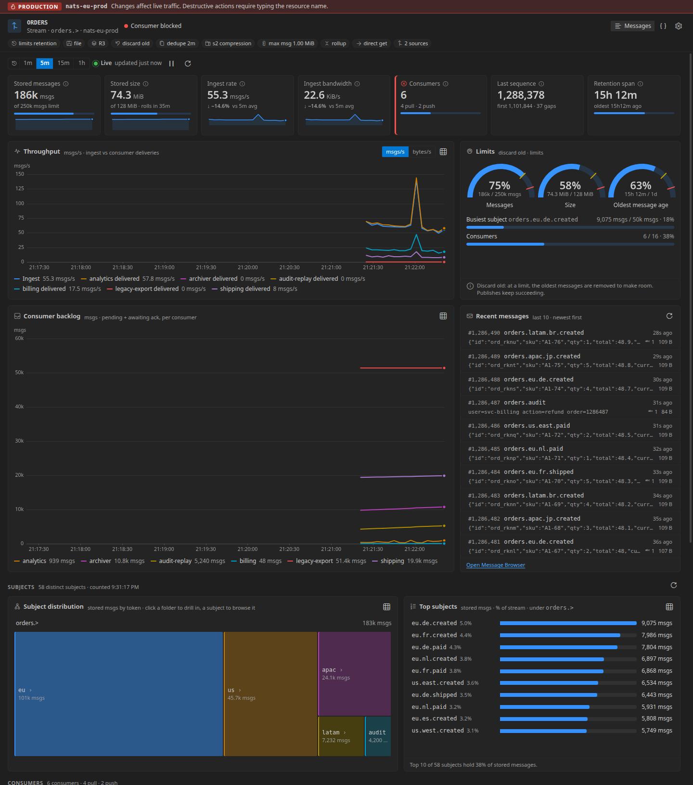

---

## Highlights

- **Zero-config connections.** NATS CLI contexts, `NATS_URL`, team connections from workspace settings and a local server are picked up automatically.
- **Production-safe.** Connections are labelled by environment (prod shows in red), can be made read-only, and need a typed confirmation for destructive actions.
- **See everything at a glance.** Fleet Home, server, stream and cluster dashboards, plus an Overview sidebar.
- **Health check ("JetStream doctor").** Best-practice findings with fixes, shown as badges right in the tree.
- **Key-Value as data structures.** Hierarchical keys, JSON shape analysis, editable values with conflict detection, and history diffs.
- **Topology graph.** Subjects → streams → consumers, mirrors, sources and services, all on one canvas.
- **Config as code.** Export streams, consumers and buckets to JSON, validate them against schemas, then plan and apply with drift detection.
- **Messaging tools.** Message Browser, Consumer Lab, Live Tail, Publisher, Request/Reply, a Dead Letter monitor and `.nats` playbooks.

## Tour

### NATS Home: your fleet at a glance
Every connection grouped by environment, with live throughput, storage, health score and one-click actions.

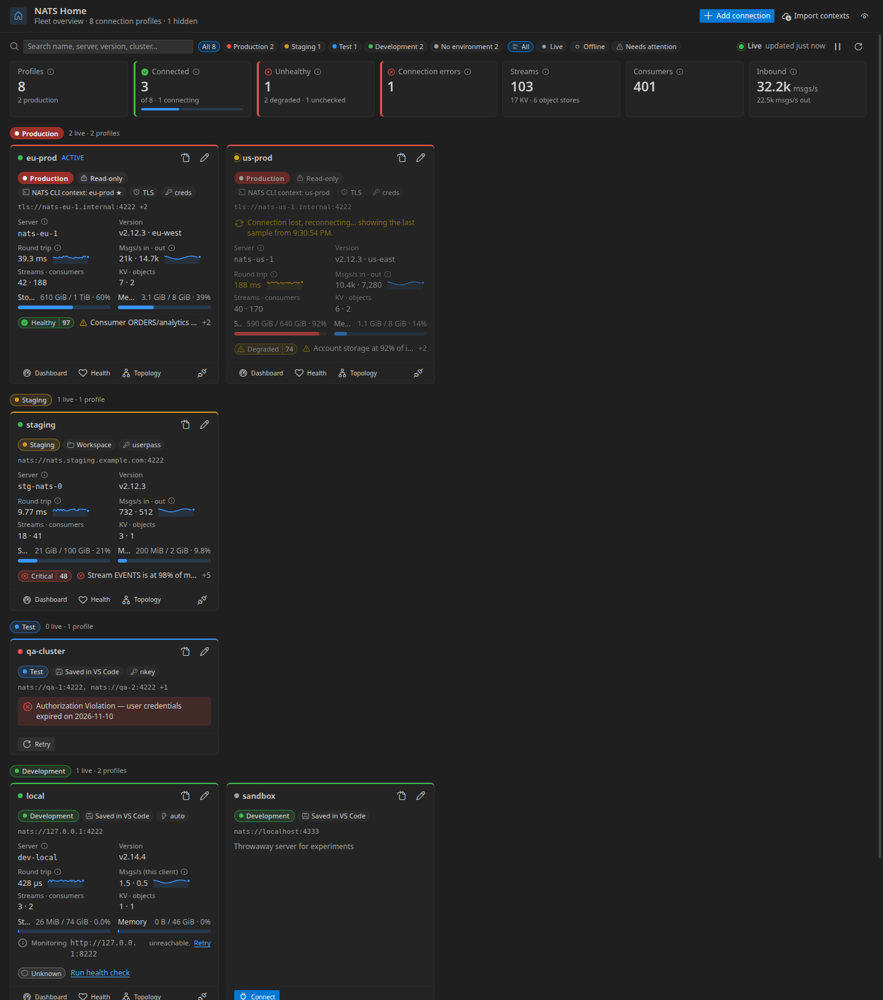

### Overview sidebar
A compact live view of the active connection, with RTT, msgs/s, JetStream usage, health and quick actions.

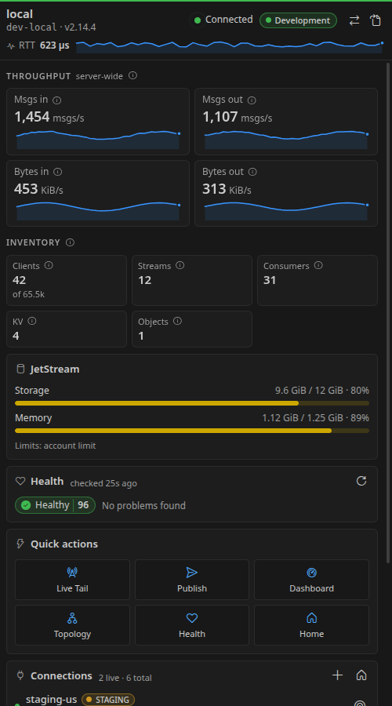

### Server dashboard
Server identity, live charts for messages, bytes, CPU and RTT, JetStream account limits, client connections and a streams ↔ subjects router.

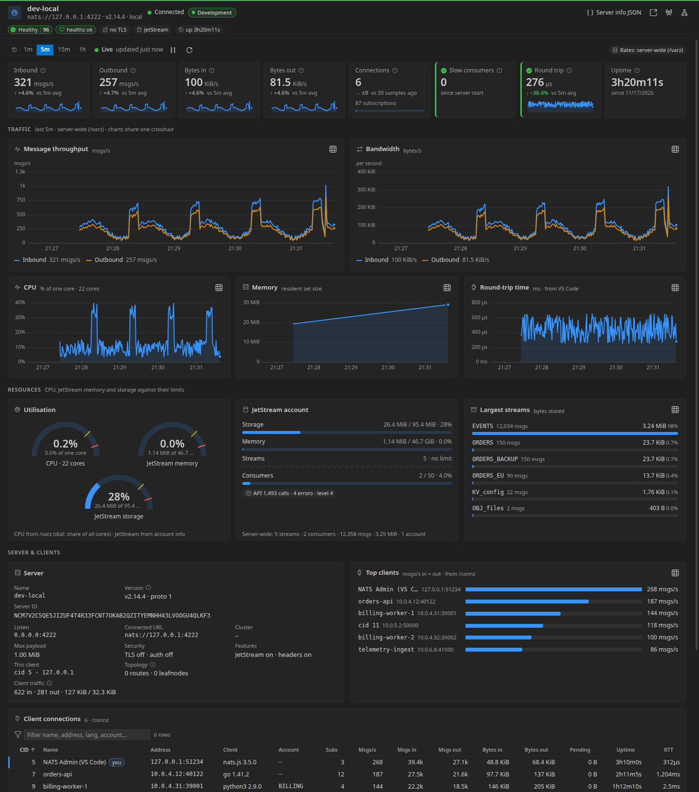

### Stream dashboard
Ingest rate, limit gauges, a subject treemap, consumer backlog, replicas, sources and recent messages.

### Health check
Dozens of checks are scored, explained and linked to fixes. Among them:

- unbounded streams and limits nearly reached;
- single replicas in a cluster and lagging replicas;
- consumers falling behind or stalled at max ack pending;
- poison-message loops;
- old servers and slow consumers.

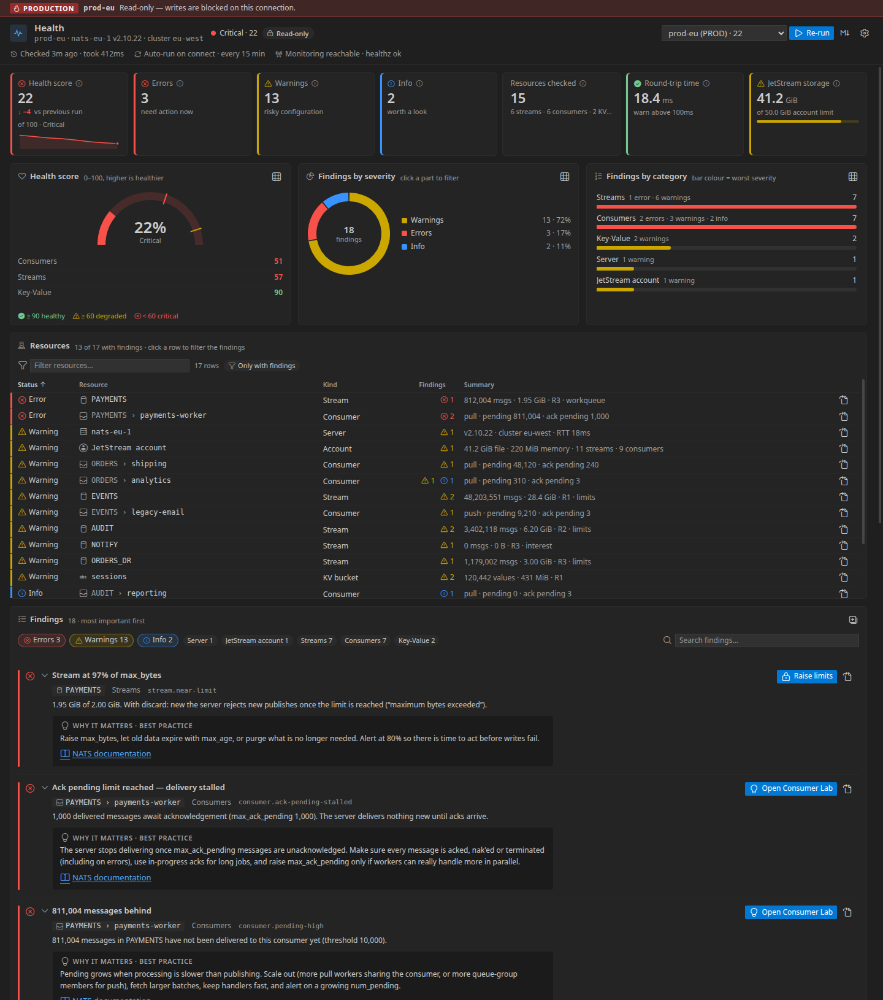

### Topology
An interactive graph of how subjects, streams, consumers, KV and object buckets, mirrors, sources and services connect. It supports pan, zoom, search and filters, and can be exported as SVG.

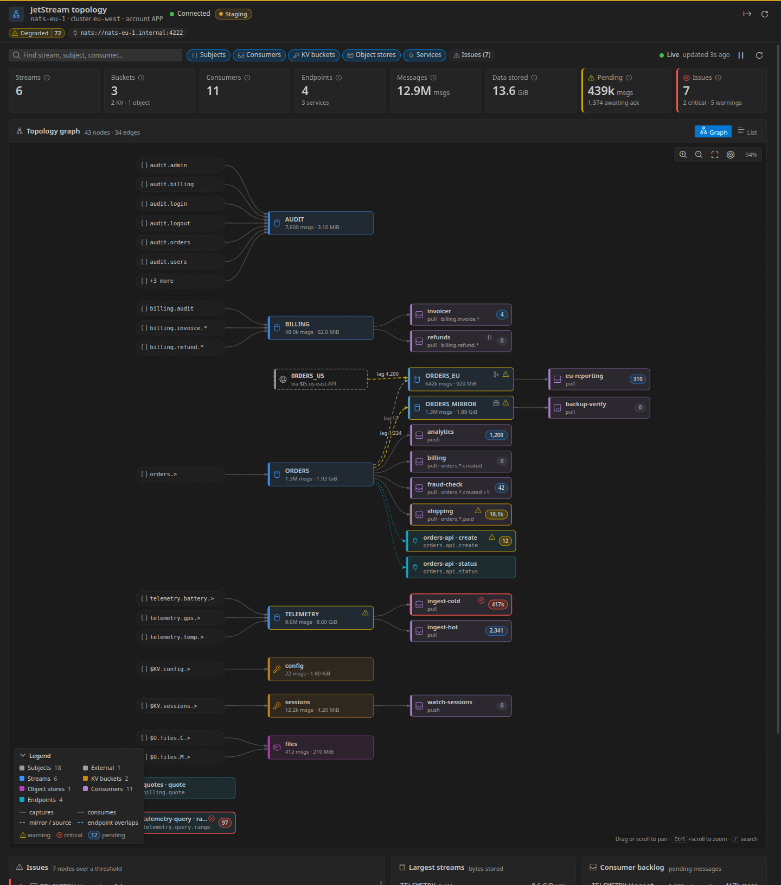

### Cluster overview
With system-account access you get every server's CPU, memory, connections and JetStream usage, plus routes, gateways and leaf nodes. Otherwise the view falls back to the connected server's monitoring endpoint. It also shows **who you are** (user, account, permissions).

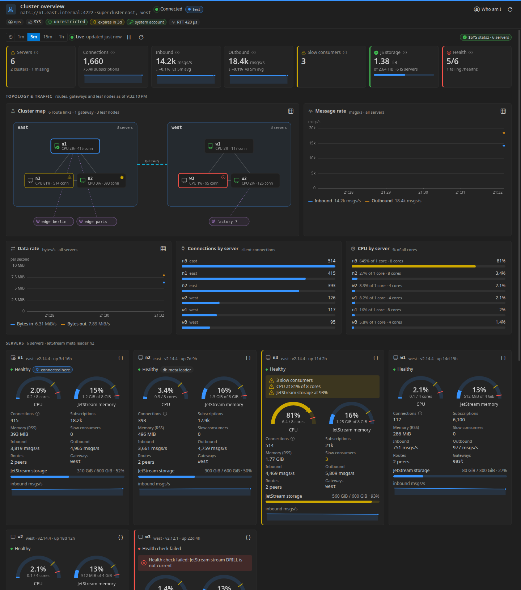

### Key-Value browser
Keys are grouped by `.` into folders, with type badges, a JSON tree, value history with diffs, and a **structure analysis** of all JSON values under a prefix: which fields exist, their types and how often they occur.

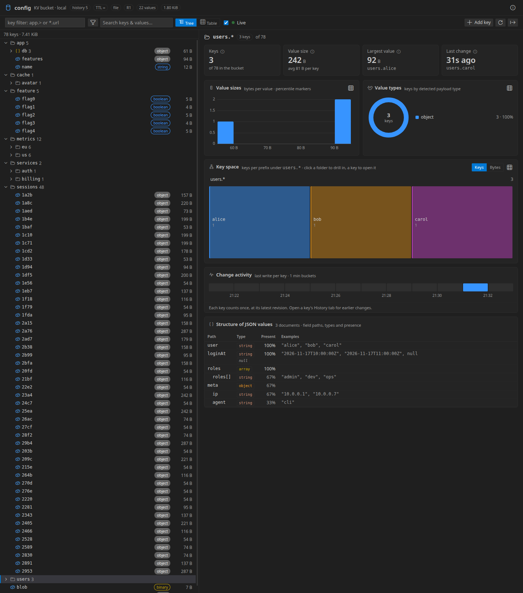

Values also open as regular editor tabs. JSON is pretty-printed and saved compact again. Saving is conflict-safe: if the key changed in the meantime you get VS Code's compare/overwrite dialog. Open tabs live-reload.

### Message Browser and Consumer Lab
Page through stored messages in both directions, by subject, sequence or time; work-queue streams are supported. Payloads can be shown as a JSON tree, text, hex, MessagePack or Protobuf. In Consumer Lab, fetch batches and ack, nak, term or mark messages in-progress.

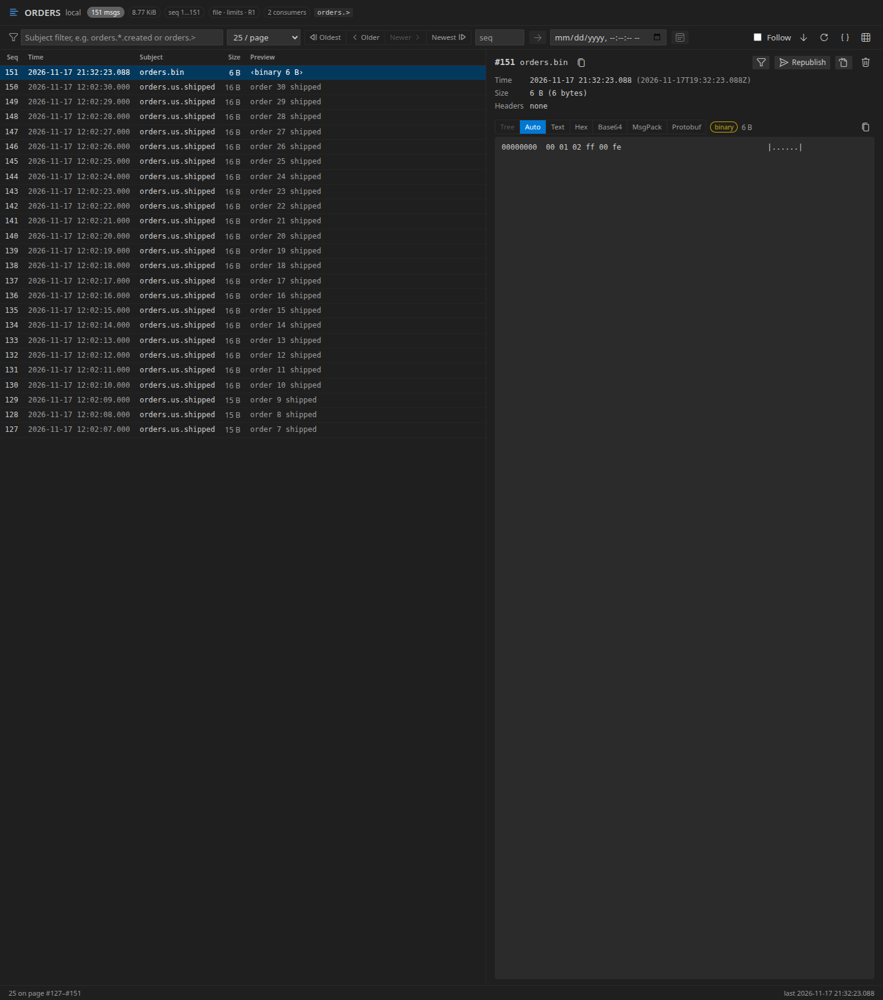
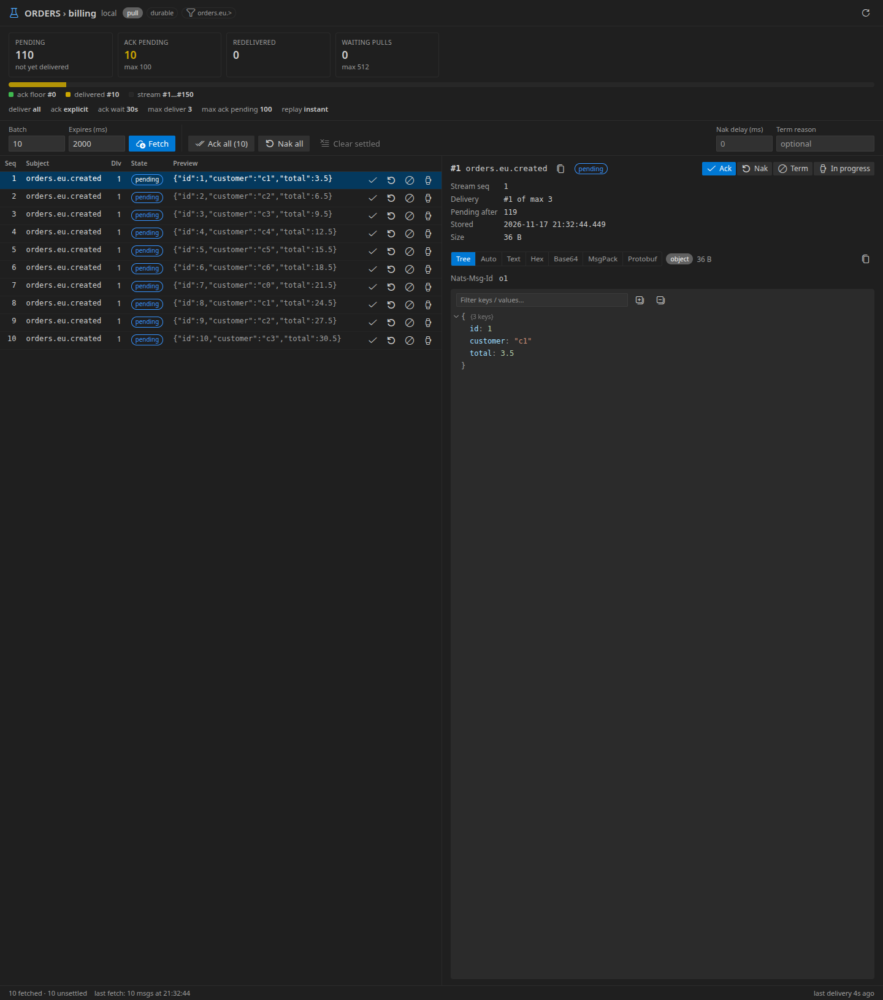

### Live Tail and Publisher
Subscribe to several subjects with queue groups, pause, filter, reply and export. Publish with templates (`{{uuid}}`, `{{seq}}`, …), headers, bursts and JetStream acks.

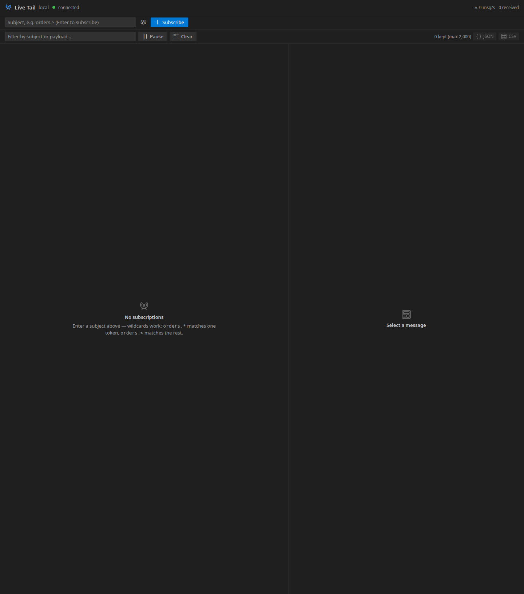

### Config as code
**Export** writes `ORDERS.stream.json`, `ORDERS.billing.consumer.json` and `config.kv.json` (compatible with `nats stream add --config`). JSON schemas give validation and hover docs. CodeLens offers **Compare** and **Apply**, and **Plan & Apply** shows a terraform-style plan.

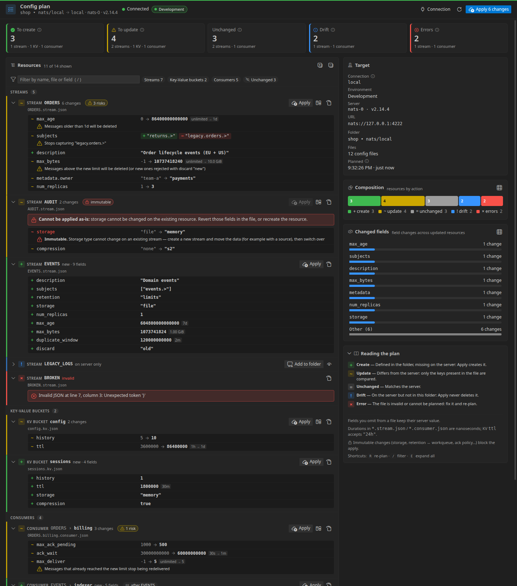

## Getting started

1. Install **NATS Admin** from the Marketplace, or run `code --install-extension nats-admin-<version>.vsix`.
2. Open the **NATS** icon in the activity bar. Your NATS CLI contexts are already listed (★ marks the selected one). You can also click **Add Connection**, or **Connect to localhost** when a local server is running.
3. Click a connection to connect. Open **Help → Get Started → Get started with NATS Admin** for a guided tour.

No server at hand? Run `nats-server -js -m 8222` (JetStream plus monitoring).

## Safety model

| | Development / test | Staging | Production |
| --- | --- | --- | --- |
| Colour (tree, status bar, terminal, dashboards) | green / blue | yellow | **red banner** |
| Destructive actions | modal confirmation | modal confirmation | **type the resource name** |
| Confirmations can be disabled | yes | yes | no |

**Read-only mode** works on any connection. It blocks publishing, KV, stream, consumer and object changes, purges, acks and consumer fetches. KV and config editors open read-only. Browsing, subscriptions and requests keep working.

Secrets are stored in your OS keychain (VS Code SecretStorage), never in settings. CLI context secrets stay in your context files.

## Documentation

- [User guide](docs/USER_GUIDE.md): every feature, the playbook format, file conventions and settings.
- [Publishing & development](docs/PUBLISHING.md): build, test, package and publish.
- [Changelog](CHANGELOG.md)

## Requirements

- VS Code 1.95 or newer.
- NATS server 2.10 or newer recommended. Consumer pause and reset need 2.11+.
- For dashboards: the HTTP monitoring port (`-m 8222`). For the full cluster view: system-account credentials.

## License

[MIT](LICENSE). Not affiliated with Synadia or the NATS project. NATS is a trademark of its respective owner.
